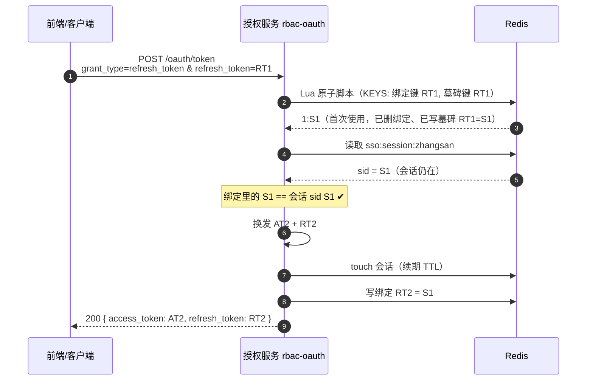
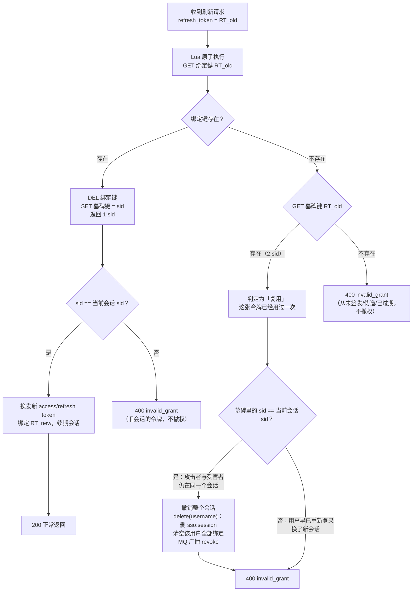
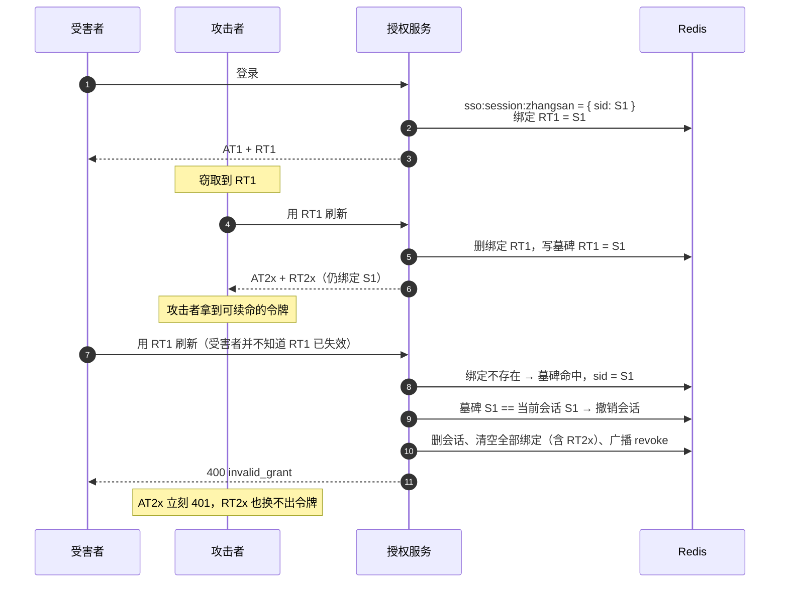
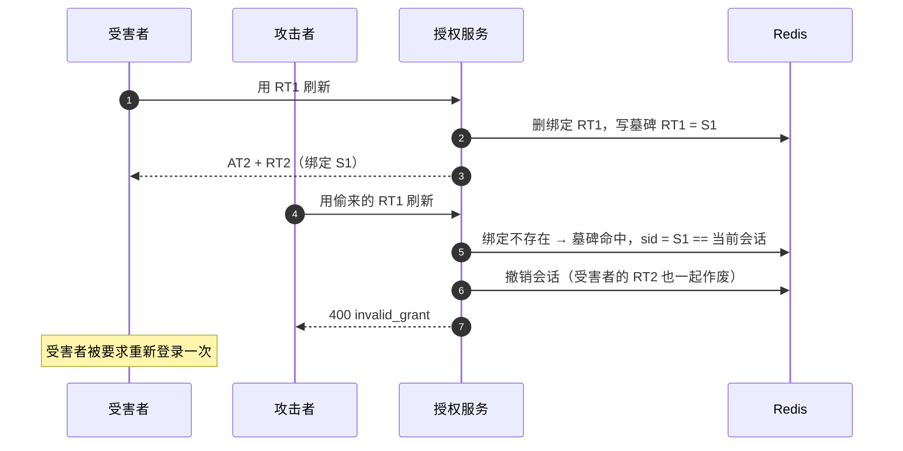

# 刷新令牌轮换与复用检测（附流程图）

> 对应代码：`rbac-oauth`
>
> - `security/SsoSessionStore.java` —— 绑定键、墓碑键、Lua 原子消费
> - `oauth/SsoTokenServices.java#refreshAccessToken` —— 复用判定与会话撤销

## 一、先厘清三个概念

| 名称 | 内容 | 作用 |
|---|---|---|
| **sid** | 会话标识，存在 `sso:session:{username}` 里 | 一次登录 = 一个 sid；正常刷新 **sid 不变**，重新登录才换 |
| **绑定键** `sso:refresh-sid:{sha256(RT)}` | 值 = 签发时的 sid | 服务端对"这张刷新令牌"的签发登记，保证**一次性**、可吊销 |
| **墓碑键** `sso:refresh-used:{sha256(RT)}` | 值 = 被消费时的 sid | 标记"这张刷新令牌**已经用过**"，用来区分「复用」和「从未签发」 |

关键点：刷新令牌是自包含 JWT，验签能过、`exp` 没到，服务端本来没有任何理由拒绝它。  
**绑定键**是服务端额外记的一笔账，删掉它，令牌就"作废"了——这才是刷新令牌能一次性、能被登出吊销的原因。

## 二、正常刷新流程

注意两点：

- **sid 全程是 S1**，刷新不是新登录，不轮换会话；
- RT1 的绑定被删除、墓碑被写入，**RT1 从此不能再用**（一次性）。

## 三、刷新时的判定流程（核心）

三种结果的区别就是这次改动的全部意义：

| 场景 | 绑定键 | 墓碑键 | 结果 |
|---|---|---|---|
| 首次使用 | 有 | 无 | 正常换发 |
| **复用（用过第二次）** | 无 | **有** | **撤会话 + 广播撤权** |
| 从未签发 / 伪造 | 无 | 无 | 仅拒绝 |

## 四、攻击者是"先用"还是"后用"

### 情况 A：攻击者先用了偷来的 RT1

**没有复用检测时**：受害者这一步只拿到 400，攻击者的 RT2x 和会话 S1 仍然活着。  
只有等受害者**重新登录**（sid 轮换成 S2、清绑定、广播），攻击者才会失效。  
复用检测把"等受害者重新登录"提前成"服务端发现即撤销"。

### 情况 B：受害者先刷新，攻击者后放重放

这种情况下受害者"多踢一次"是安全上的必要代价：服务端无法区分谁是真正的令牌主人，只能把这一族令牌全部作废。

## 五、为什么用户"重新登录"不是等价替代

受害者收到 400 后重新登录，确实会轮换 sid 并撤掉攻击者。但：

1. **400 不必然导致重新登录**：前端往往只弹提示，access token 还有 30 分钟有效期，用户可能过很久才回来；
2. **受害者可能很久不刷新**：攻击者先用 RT1 换走 RT2x 后，受害者要等到下次刷新才会收到 400，这段时间攻击者一直可用；
3. **复用检测不依赖前端行为**：服务端在发现复用的瞬间就撤销，攻击者的下一次调用即 401；
4. **它是唯一能产生"令牌已泄露"信号的路径**，可接 Prometheus / 企业微信告警，用于安全审计。

## 六、键与配置

| 键 / 配置 | 说明 |
|---|---|
| `sso:session:{username}` | SSO 会话，sid 的权威来源 |
| `sso:refresh-sid:{sha256(RT)}` | 刷新令牌绑定，值 = sid；消费即删除 |
| `sso:refresh-sid:user:{username}` | 用户名下的绑定哈希集合，登出/轮换时批量清理 |
| `sso:refresh-used:{sha256(RT)}` | 已用墓碑，值 = sid；复用检测依据 |
| `rbac.sso.refresh-reuse-ttl-seconds` | 墓碑 TTL，默认 604800（7 天），与 `clientdetails.refresh_token_validity` 对齐 |

墓碑 TTL 必须 ≥ 刷新令牌有效期，否则令牌还没过期、墓碑先消失，复用会被误判成"从未签发"。
