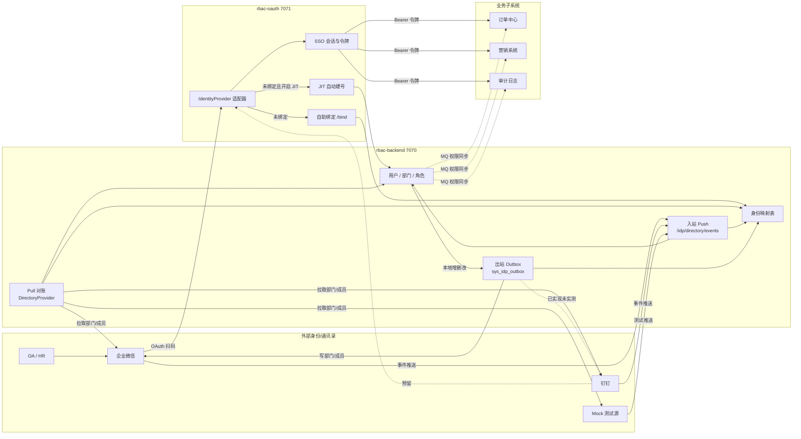
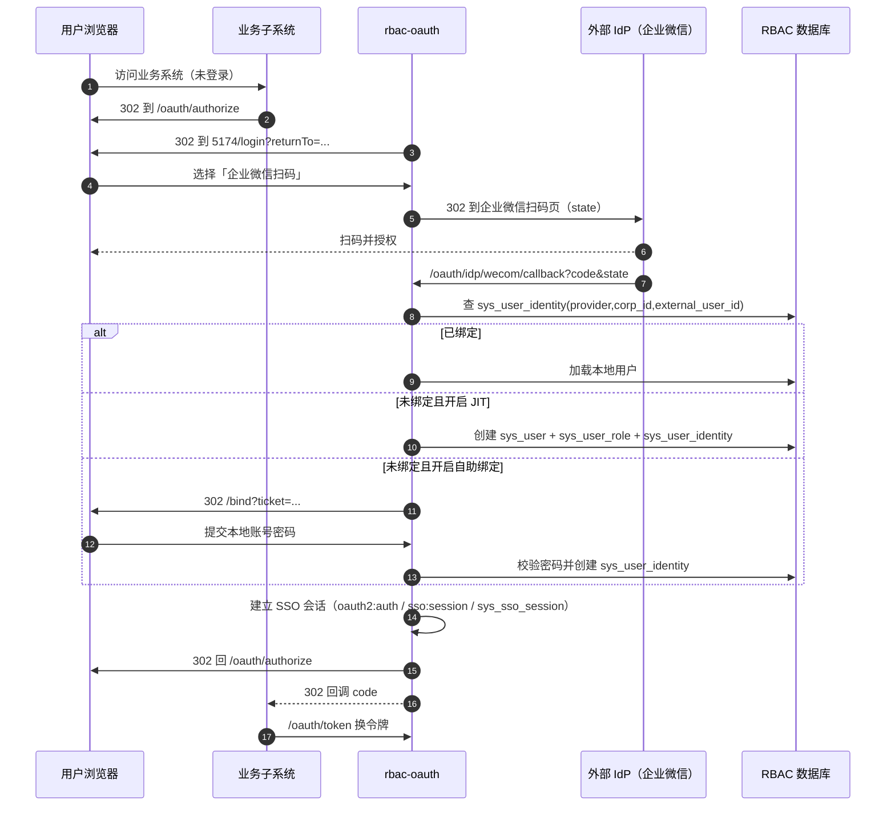
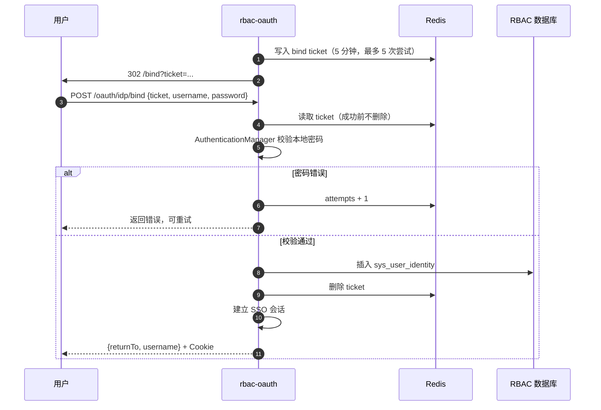
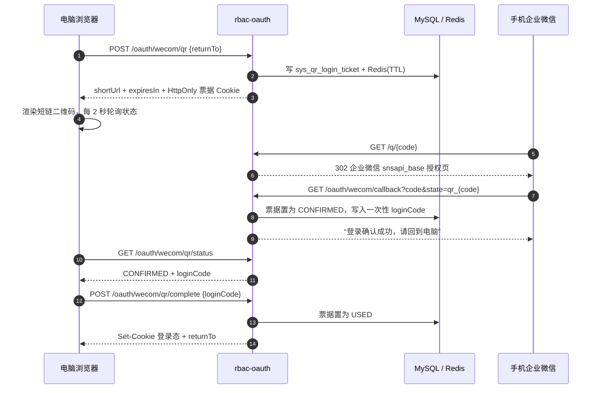
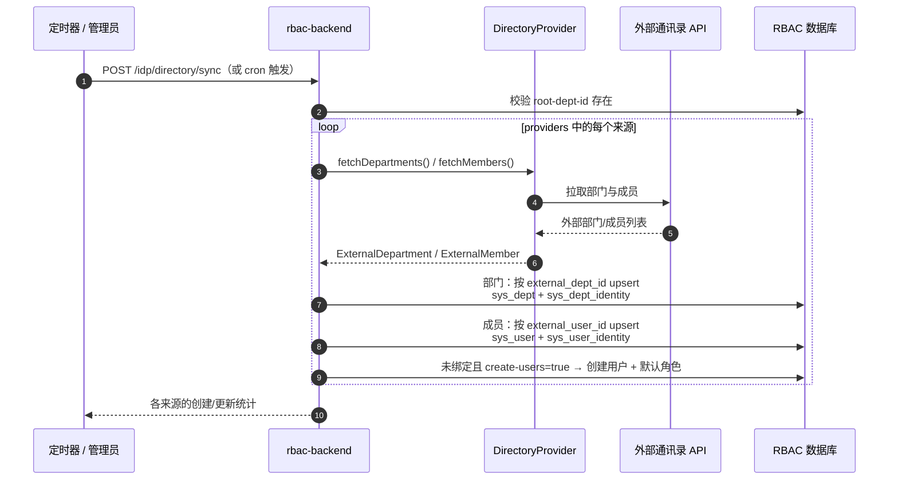
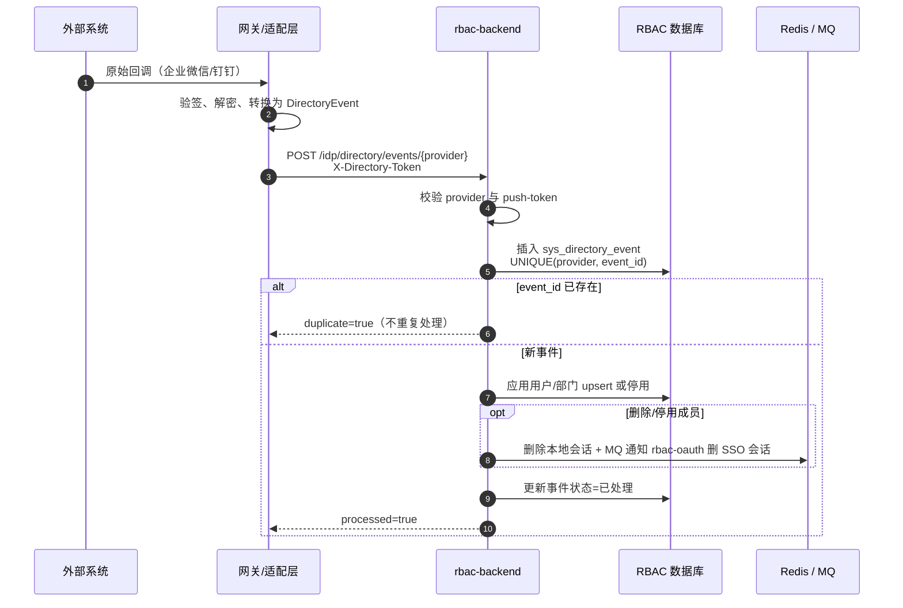
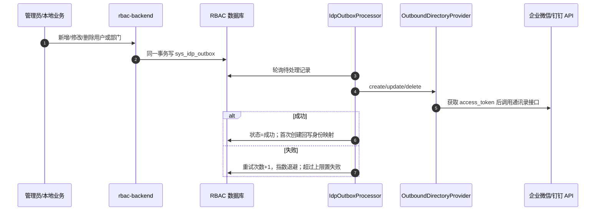
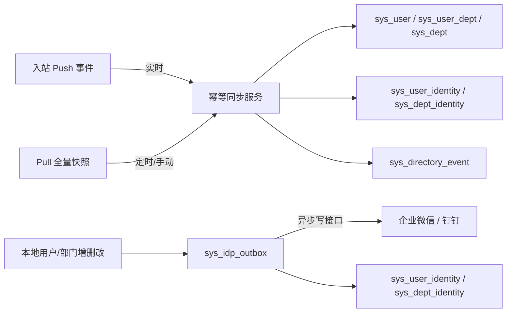
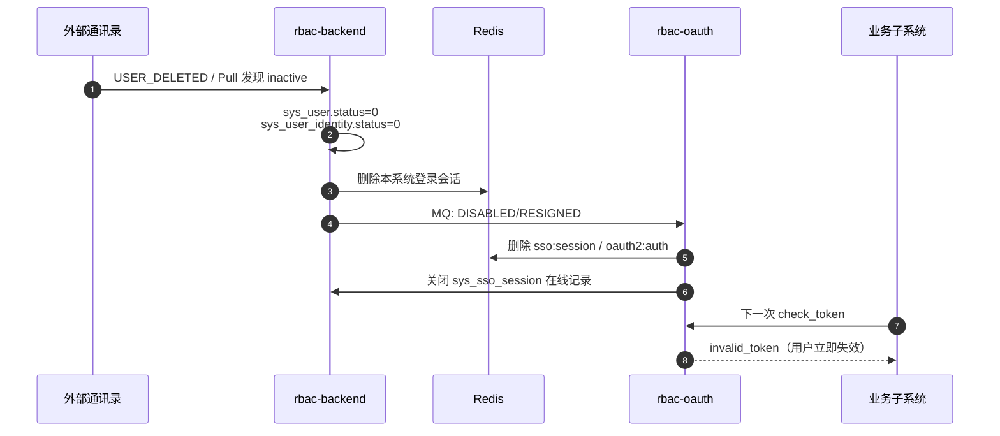

# 用户信息同步与外部通讯录对接说明

> 本文档描述 RBAC 系统中「用户信息同步」的完整设计：
> 外部身份登录、用户/部门拉取（Pull）、入站事件（外部 → RBAC）、
> 出站推送（RBAC → 企业微信/钉钉）、JIT 自动建号、自助绑定、
> 离职/停用处理，以及数据一致性与运维方式。
>
> 适用版本：2026-10-18 之后的代码。企业微信写接口已于 2026-10-18 实测通过。

---

## 1. 总体设计

### 1.1 核心原则

1. **认证与供给分离**
   - 认证：用户是谁（企业微信扫码、钉钉、OIDC、账号密码）；
   - 供给：用户与组织数据从哪来（Pull / Push / JIT / 自助绑定）。
2. **明确唯一权威源（Source of Truth）**
   - 同一字段在部署时只能选一个写入方向，避免 Pull 与出站 Push 互相覆盖；
   - **入站模式（外部权威）**：人员、部门、手机号以 HR/OA、企业微信/钉钉为准，RBAC 只读接收；
   - **出站模式（RBAC 权威）**：RBAC 维护的用户/部门资料写入企业微信/钉钉通讯录；
   - **角色、权限、菜单、数据范围始终只以 RBAC 为准**，任何模式都不写回外部。
3. **Push 有两种方向**
   - **入站 Push**：外部通讯录事件 → `POST /idp/directory/events/{provider}`，用于实时变更；
   - **出站 Push**：RBAC 本地变更 → `sys_idp_outbox` → 企业微信/钉钉写接口；
   - Pull 负责首次基线与丢事件补偿；入站 Push、出站 Push、Pull 三者共用同一套幂等映射。
4. **不物理删除主数据**
   - 外部成员删除/离职 → 本地用户停用、身份解绑、踢下线；
   - 外部部门删除 → 本地部门禁用，保留历史与审计；
   - 本地删除用户/部门时，出站只调用外部删除接口，本地映射标记失效。

### 1.2 服务职责

| 服务 | 端口 | 职责 |
|---|---|---|
| **rbac-oauth** | 7071 | 外部 IdP 登录、自助绑定、JIT 自动建号、SSO 会话 |
| **rbac-backend** | 7070 | 用户/部门/角色管理、身份绑定维护、通讯录 Pull、入站事件、出站 Outbox 推送 |
| **rbac-oauth-web** | 5174 | 登录页、自助绑定页 `/bind` |
| **业务子系统** | 5176/5175/5178... | 只消费 SSO 令牌与同步表，不参与用户同步 |

### 1.3 总体架构



---

## 2. 数据模型

### 2.1 核心表

| 表 | 作用 | 关键字段 |
|---|---|---|
| `sys_user` | 本地用户 | `username`、`nickname`、`employee_no`（工号）、`dept_id`（主部门）、`alias`、`position`、`gender`、`biz_mail`、`telephone`、`direct_leader`、`external_position`、`external_nickname`、`address`、`ext_attr`、`status`（1在职/0停用/2离职） |
| `sys_user_dept` | **用户与部门关联（多部门）** | `user_id`、`dept_id`、`is_main`、`is_leader`、`order_in_dept` |
| `sys_dept` | 本地组织树 | `parent_id`、`dept_name`、`type`（1公司/2分公司/3部门）、`status` |
| `sys_role` / `sys_user_role` | 角色与用户角色 | `role_key`、`user_id`、`role_id` |
| `sys_user_identity` | **外部身份映射** | `provider`、`corp_id`、`external_user_id`、`union_id`、`user_id`、`status`、`last_login_time` |
| `sys_dept_identity` | **外部部门映射** | `provider`、`corp_id`、`external_dept_id`、`dept_id`、`status` |
| `sys_directory_event` | **入站 Push 幂等记录** | `provider`、`event_id`（唯一）、`event_type`、`status`、`error_msg` |
| `sys_idp_outbox` | **出站 Push Outbox** | `provider`、`operation`、`target_type`、`target_id`、`payload`、`status`、`retry_count`、`next_retry_time`、`last_error` |
| `sys_qr_login_ticket` | **企业微信扫码短链票据** | `code`（唯一）、`provider`、`return_to`、`status`（PENDING/CONFIRMED/USED/EXPIRED/FAILED）、`login_code`、`expire_time`、`confirmed_time`、`used_time` |
| `sys_sso_session` | SSO 登录会话 | `username`、`login_ip`、`device`、`login_type`（PASSWORD/WECOM/MOCK）、`status` |

### 2.2 唯一约束

```text
sys_user_identity : UNIQUE(provider, corp_id, external_user_id)
sys_dept_identity : UNIQUE(provider, corp_id, external_dept_id)
sys_user_dept     : UNIQUE(user_id, dept_id)
sys_directory_event: UNIQUE(provider, event_id)
```

这些唯一键是**幂等同步的基础**：

- 同一外部身份不会重复绑定；
- 同一外部部门不会重复建节点；
- 同一用户不会重复挂同一部门；
- 同一入站事件不会被处理两次；
- 出站通过 `target_type + target_id + operation` 检查待处理 CREATE，避免“创建后立即修改”产生重复建号。

---

## 3. 外部身份登录流程

### 3.1 授权码 / 外部 IdP 登录



关键接口：

| 接口 | 说明 |
|---|---|
| `GET /oauth/providers` | 登录页获取已启用的 IdP |
| `GET /oauth/idp/{provider}/authorize?returnTo=` | 发起外部登录（state 5 分钟、一次性） |
| `GET /oauth/idp/{provider}/callback?code=&state=` | IdP 回调 |
| `POST /oauth/idp/bind` | 自助绑定（ticket + 用户名 + 密码） |
| `GET /oauth/wecom/authorize|callback` | 企业微信兼容入口 |

### 3.2 自助绑定



安全点：

- ticket 一次性、短命、限尝试次数；
- 必须验证本地密码，防止外部账号抢占已有本地账号；
- 外部身份已绑定其他用户时拒绝。

### 3.3 JIT 自动建号

开启条件：`idp.jit.enabled=true`。

```text
外部身份未绑定
  → 生成唯一用户名：前缀 + externalUserId（非法字符替换、冲突追加序号）
  → 随机密码（BCrypt，不能用于密码登录）
  → 默认部门 idp.jit.default-dept-id
  → 默认角色 idp.jit.default-role-keys
  → 写入 sys_user / sys_user_role / sys_user_identity
  → 建立 SSO 会话
```

建议：生产启用前确认企业通讯录可信，避免任意通讯录成员自动获得系统账号。

> JIT 自动建号发生在 `rbac-oauth`，直接写 `sys_user`，不会经过 `rbac-backend` 的 outbox。如果开启了出站 Push，JIT 新建的用户需要手动同步或重新执行一次全量推送。

### 3.4 企业微信扫码登录（短链二维码）

登录页展示的二维码内容不是企业微信授权页，而是本服务的短链 `https://{public-base-url}/q/{code}`；手机扫码后才进入企业微信授权码流程。



| 接口 | 说明 |
|---|---|
| `POST /oauth/wecom/qr` | 创建短链票据，返回 `shortUrl`、`expiresIn`，并写入 HttpOnly Cookie |
| `GET /q/{code}` | 二维码短链；有效则 302 到企业微信 `snsapi_base` 授权页，过期返回 410 |
| `GET /oauth/wecom/qr/status` | 电脑端轮询；只认创建票据时的 HttpOnly Cookie |
| `POST /oauth/wecom/qr/complete` | 电脑端用一次性 `loginCode` 建立 SSO 会话并返回 `returnTo` |

有效期与存储：

- 票据同时写入 MySQL `sys_qr_login_ticket` 与 Redis `oauth2:qr:login:{code}`；
- 二维码默认 300 秒过期（`wecom.qr.ttl-seconds`），Redis TTL 到期自动删除，数据库保留记录；
- 手机确认后，电脑端默认还有 120 秒完成登录（`wecom.qr.confirm-ttl-seconds`）；
- 每个短链只能完成一次登录，完成后票据置为 `USED`，Redis 删除；
- 状态与完成接口都要求创建票据时的 HttpOnly Cookie，扫码者或泄露的短链无法劫持电脑端会话。

前置条件：

1. `wecom.callback-url` 必须是手机可访问的公网地址；
2. `wecom.qr.public-base-url` 必须是手机可访问的短链域名，通常与回调同域；
3. 企业微信后台需要把该域名配置到自建应用的「网页授权及JS-SDK → 可信域名」，回调地址与 `snsapi_base` 授权才能通过校验；
4. 隧道/反向代理需要同时转发 `/oauth/**` 与 `/q/**` 到 rbac-oauth（7071）。

---

## 4. Pull：定时拉取外部用户数据

### 4.1 职责

`rbac-backend` 通过 `DirectoryProvider` 主动拉取外部通讯录，做**全量快照对账**：

| Provider | 说明 |
|---|---|
| `wecom` | 企业微信通讯录 API（部门 + 成员） |
| `dingtalk` | 钉钉通讯录（当前 Mock 实现，真实接入时替换 Provider） |
| `mock` | 固定测试数据，用于本地联调 |

> 企业微信 Pull 依赖 `GET /cgi-bin/department/list` 与 `GET /cgi-bin/user/list`。当前使用的「通讯录同步助手」Secret 从新增 IP 调用这两个接口会返回 `48009`，因此 Pull 暂时不可用；写接口不受影响，详见 5.5。

配置支持多来源：

```yaml
idp:
  directory-sync:
    enabled: true
    providers: wecom,dingtalk,mock
```

### 4.2 拉取流程



关键行为：

- **部门**：首次在 `root-dept-id` 下创建，后续更新名称、父节点、状态；
- **成员**：
  - 已绑定 → 更新昵称、多部门、手机号/邮箱、状态，以及工号、别名、职务、性别、企业邮箱、座机、直属上级、对外职务/昵称、地址、扩展属性；
  - 未绑定且 `create-users=true` → 自动建号并绑定（含多部门关联）；
  - 未绑定且 `create-users=false` → 跳过。
- **幂等**：重复执行不会重复建部门/用户，只会更新；
- **多来源**：每个来源独立按 `provider + corp_id` 映射，互不串号。

### 4.3 触发方式

| 方式 | 说明 |
|---|---|
| 手动 | `POST http://localhost:7070/idp/directory/sync`（`system:user:edit`） |
| 定时 | `idp.directory-sync.enabled=true`，按 `cron` 执行（默认每天 03:00） |

返回示例：

```json
{
  "providers": [
    {"provider": "mock", "enabled": true, "departments": 3, "members": 2, "createdUsers": 1, "updatedUsers": 1},
    {"provider": "dingtalk", "enabled": true, "departments": 3, "members": 2, "createdUsers": 2, "updatedUsers": 0}
  ],
  "departments": 6,
  "members": 4,
  "createdUsers": 3,
  "updatedUsers": 1
}
```

---

## 5. 入站 Push：外部事件推送

### 5.1 入口

```
POST http://localhost:7070/idp/directory/events/{provider}
X-Directory-Token: <idp.directory-sync.push-token>
Content-Type: application/json
```

统一事件格式：

```json
{
  "eventId": "evt-20261018-001",
  "eventType": "USER_CREATED",
  "externalUserId": "ding-user-003",
  "name": "Ding Three",
  "mobile": "13900000003",
  "email": "ding3@example.com",
  "departmentIds": ["101"],
  "active": true
}
```

支持的事件：

| 类型 | 行为 |
|---|---|
| `USER_CREATED` / `USER_UPDATED` | 已绑定则更新；未绑定且允许建号则创建 |
| `USER_DELETED` | 本地用户停用、身份解绑、踢 SSO 会话 |
| `DEPT_CREATED` / `DEPT_UPDATED` | 按 external_dept_id upsert |
| `DEPT_DELETED` | 本地部门禁用，保留历史 |

### 5.2 推送处理流程



### 5.3 幂等与失败处理

- `provider + event_id` 唯一，重复投递返回 `duplicate=true`；
- 事件先落库（状态=已接收），再执行业务；
- 成功 → 状态=已处理；失败 → 状态=失败 + `error_msg`，便于排查；
- 真实厂商回调应在网关/适配层完成签名校验、解密和格式转换；
- **Push 不能替代 Pull**：定时拉取继续作为丢事件、乱序和首次基线的对账兜底。

### 5.4 出站 Push：RBAC → 企业微信/钉钉

与 5.1 的入站事件方向相反：出站 Push 由 `rbac-backend` 主动把本地用户/部门写入外部通讯录。



| provider | 实现 | 配置 |
|---|---|---|
| `wecom` | `WeComOutboundProvider` | `wecom-corp-id`、`wecom-secret`、`wecom-api-base-url` |
| `dingtalk` | `DingTalkOutboundProvider` | `dingtalk-app-key`、`dingtalk-app-secret`、`dingtalk-api-base-url` |
| `mock` | `MockOutboundProvider` | 仅记录日志，用于联调 |

支持的操作：`USER_CREATE` / `USER_UPDATE` / `USER_DELETE`、`DEPT_CREATE` / `DEPT_UPDATE` / `DEPT_DELETE`。

关键行为：

- 本地用户/部门变更与 outbox 写入在**同一事务**内完成，外部接口故障不会回滚本地业务；
- 后台 `IdpOutboxProcessor` 默认每 5 秒取一批待处理记录，失败按 `10s × 重试次数` 指数退避，默认最多 5 次；
- 首次创建成功后回写 `sys_user_identity` / `sys_dept_identity`，后续更新与删除都按外部 ID 定位；
- 已绑定用户按绑定关系更新；未绑定用户的 userid 依次取：绑定的外部 userid → 工号 → 合法用户名 → `u{userId}`；
- 用户名/工号必须满足 `^[A-Za-z0-9][A-Za-z0-9_-]{0,63}$`，否则自动生成 `u{userId}`；
- 用户的多个部门通过 `sys_user_dept` 解析为外部部门 ID，主部门排第一；
- 直属上级填本地用户名时，出站会自动翻译成该提供方下的外部 userid；
- 角色、权限、菜单、数据范围**永远不写回外部**；
- 入站 `POST /idp/directory/events/{provider}` 与出站 outbox 相互独立，不会形成回环；
- 钉钉通讯录接口不支持“停用成员”，本地 `enabled=false` 时只记录告警，需要停用请在钉钉侧处理或改用删除。

管理端手动入口：

```text
GET  /idp/outbound/providers
POST /idp/outbound/sync-all?provider=wecom|dingtalk     # 全量：先部门后用户
POST /idp/outbound/user/{userId}?provider=wecom|dingtalk
POST /idp/outbound/dept/{deptId}?provider=wecom|dingtalk
```

全量推送规则：

- 本地根部门（默认 id=1）映射到企业微信/钉钉根部门 `1`，不重复创建；
- 部门按父子关系 BFS 入队，父部门先创建；子部门的父级外部 ID 在处理时解析；
- 用户的部门映射也在处理时解析，避免部门尚未创建导致用户挂错部门；
- 企业微信已存在同一 `userid` 时自动转为更新（`errcode=60102`）；
- 同名同父部门已存在时复用现有部门（`errcode=60003`，需要通讯录读权限）；
- 部门创建返回 `60004`（父部门不存在）时，通常是父部门尚未创建成功；outbox 会按重试策略继续，父部门成功后子部门自然恢复；
- 重复执行全量推送是幂等的：已映射的部门/用户会转为更新，不会重复创建。

> **企业微信前置条件**：应用需要具备通讯录管理权限，并在企业微信后台把后端出口 IP 加入「企业可信IP」，否则接口返回 `60020 not allow to access from your ip`。当前部署已将出口 IP `120.229.32.160` 加白，部门创建与成员创建接口已实测通过。

### 5.5 企业微信接入现状（2026-10-18 实测）

| 能力 | 接口 | 状态 |
|---|---|---|
| 获取 token | `GET /cgi-bin/gettoken` | 正常 |
| 创建部门 | `POST /cgi-bin/department/create` | 实测通过 |
| 创建成员 | `POST /cgi-bin/user/create` | 实测通过 |
| 更新部门 | `POST /cgi-bin/department/update` | 已实现，未实测 |
| 更新成员 | `POST /cgi-bin/user/update` | 已实现，未实测 |
| 删除部门/成员 | `POST /cgi-bin/department/delete` / `user/delete` | 已实现，未实测 |
| 读取部门列表 | `GET /cgi-bin/department/list` | `48009 api forbidden for contact assistant` |
| 读取成员列表 | `GET /cgi-bin/user/list` | `48009 api forbidden for contact assistant` |

全量推送实测结果：

| 本地部门 | 本地 ID | 企业微信部门 ID |
|---|---|---|
| 总公司（根） | 1 | 1 |
| 北京分公司 | 8 | 2 |
| 上海分公司 | 9 | 3 |
| 研发部 | 2 | 4 |
| 前端组 | 4 | 5 |
| 后端组 | 5 | 6 |
| 市场部 | 3 | 7 |

| 本地用户 | 企业微信 userid |
|---|---|
| admin | admin |
| zhangsan | zhangsan |
| 李四（中文用户名） | u3 |

**48009 说明**：企业微信出于安全策略，不允许「通讯录同步助手」Secret 从**新增的可信 IP** 读取通讯录详情。它不影响创建/更新/删除成员和部门，但会导致：

- `POST /idp/directory/sync`（Pull）失败；
- 创建部门遇到 60003 时的“按名称复用”回退失败；
- 无法通过 API 核对企业微信现有部门和成员。

解决办法二选一：

1. 改用开通了「通讯录管理」权限的**自建应用 Secret**（推荐，可同时用于 Pull 和出站 Push）；
2. 使用企业微信已允许读取通讯录的既有可信 IP。

---

## 6. 入站、出站与 Pull 的一致性



| 场景 | 由谁负责 |
|---|---|
| 外部新员工/离职尽快生效 | 入站 Push |
| 本地新增/调整用户后同步到企业微信 | 出站 Push（Outbox） |
| 首次接入、系统故障恢复 | Pull 全量 |
| 入站推送丢失/乱序 | Pull 对账 |
| 部门调整 | 按部署选择的权威方向单向同步 |
| 角色权限 | RBAC 本地，不写回外部 |

> 同一套字段不要同时开启「Pull 入站」和「出站 Push」，否则两边会互相覆盖。部署时必须先确定每个字段的权威方向。

---

## 7. 离职/停用处理



本地侧的停用/离职同样会触发外部同步：

- **停用**（`status=0`）→ `USER_UPDATE`，推送 `enable=0`；
- **离职**（`status=2`）→ 当前按 `USER_UPDATE` 处理，本地立即踢下线；
- **删除** → `USER_DELETE`，调用外部删除接口，映射标记失效；
- 钉钉不支持停用成员，`enable=0` 只在本地生效并记录告警。

---

## 8. 字段权威与冲突规则

| 数据 | 入站模式（外部权威） | 出站模式（RBAC 权威） |
|---|---|---|
| 姓名、工号、在职状态 | 以 HR / OA / 通讯录为准，RBAC 只读 | RBAC → 企业微信/钉钉 |
| 部门、汇报关系 | 由外部映射到 `sys_dept` | RBAC → 企业微信/钉钉 |
| 手机号、邮箱、企业邮箱、座机 | 按配置接收 | RBAC → 企业微信/钉钉 |
| 别名、职务、性别、直属上级、对外资料、地址、扩展属性 | 按配置接收 | RBAC → 企业微信/钉钉 |
| 外部 userid / unionid | 存映射表，不参与业务修改 | 首次创建时生成并回写映射 |
| 角色、权限、菜单、数据范围 | **始终以 RBAC 为准** | **不写回外部** |
| 登录方式绑定 | RBAC 映射表 | 管理员绑定或用户自助绑定 |

冲突规则：

- 一个字段只能有一个写入方；只在部署层选择一种方向；
- 出站模式下，本地资料覆盖外部通讯录，本地角色权限仍不外写；
- 入站模式下，权威源覆盖同步字段，RBAC 本地角色不被覆盖；
- 离职/停用由所选方向的权威方决定，另一侧不能反向启用；
- 若需本地例外，应加 `override` 标记、有效期和审计。

---

## 9. 配置参考

### 9.1 rbac-oauth

```yaml
wecom:
  enabled: ${WECOM_ENABLED:true}
  corp-id: ${WECOM_CORP_ID:}
  agent-id: ${WECOM_AGENT_ID:}
  secret: ${WECOM_SECRET:}            # 支持 ENC(...)
  callback-url: ${WECOM_CALLBACK_URL:https://sso.example.com/oauth/wecom/callback}
  qr-connect-url: https://open.work.weixin.qq.com/wwopen/sso/qrConnect
  api-base-url: https://qyapi.weixin.qq.com
  # 扫码登录：二维码内容为短链，票据写 MySQL + Redis
  qr:
    enabled: ${WECOM_QR_ENABLED:true}
    ttl-seconds: ${WECOM_QR_TTL_SECONDS:300}              # 二维码有效期
    confirm-ttl-seconds: ${WECOM_QR_CONFIRM_TTL_SECONDS:120} # 手机确认后电脑端等待时间
    public-base-url: ${WECOM_QR_PUBLIC_BASE_URL:https://sso.example.com}
    short-path: ${WECOM_QR_SHORT_PATH:/q}

idp:
  self-bind-enabled: true             # 未绑定时允许自助绑定
  bind-page-url: http://localhost:5174/bind
  mock-enabled: false                 # 仅测试
  jit:
    enabled: false                    # JIT 自动建号
    default-dept-id: 1
    default-role-keys: common
    username-prefix: idp_
```

### 9.2 rbac-backend

```yaml
idp:
  directory-sync:
    enabled: false
    providers: mock                   # 可多个：wecom,dingtalk,mock
    mock-enabled: false
    push-token: ${IDP_DIRECTORY_SYNC_PUSH_TOKEN:}
    cron: 0 0 3 * * ?
    root-dept-id: 1
    create-users: true
    default-role-keys: common
    username-prefix: idp_
    corp-id: mock-corp
    dingtalk-corp-id: ding-corp
    wecom-corp-id: ${WECOM_CORP_ID:}
    wecom-secret: ${WECOM_SECRET:}

  # RBAC -> 企业微信/钉钉 出站推送（当前默认启用企业微信）
  outbound:
    enabled: ${IDP_OUTBOUND_ENABLED:true}
    providers: ${IDP_OUTBOUND_PROVIDERS:wecom}   # wecom,dingtalk,mock
    max-retries: ${IDP_OUTBOUND_MAX_RETRIES:5}
    process-interval-ms: ${IDP_OUTBOUND_PROCESS_INTERVAL_MS:5000}
    root-dept-id: ${IDP_OUTBOUND_ROOT_DEPT_ID:1}
    corp-id: ${IDP_OUTBOUND_CORP_ID:mock-corp}
    dingtalk-corp-id: ${IDP_OUTBOUND_DINGTALK_CORP_ID:ding-corp}
    wecom-corp-id: ${WECOM_CORP_ID:}
    wecom-secret: ${WECOM_SECRET:}
    wecom-api-base-url: ${WECOM_API_BASE_URL:https://qyapi.weixin.qq.com}
    dingtalk-app-key: ${DINGTALK_APP_KEY:}
    dingtalk-app-secret: ${DINGTALK_APP_SECRET:}
    dingtalk-api-base-url: ${DINGTALK_API_BASE_URL:https://oapi.dingtalk.com}
```

> 生产要求：`mock-enabled` 必须为 false；`push-token` 必须是非空强随机值；JIT 按安全策略开启；`outbound.enabled=true` 时 `providers` 只能是已配置凭证的真实提供方。
>
> 当前部署 `outbound.enabled=true`、`providers=wecom`。如果只想临时关闭自动推送，设置 `IDP_OUTBOUND_ENABLED=false` 后重启即可；已经入队的记录仍会在重启后继续处理。
>
> 企业微信读接口的 `48009` 限制与 Secret 类型有关，详见 5.5；若需要 Pull，请改用具备通讯录读取权限的自建应用 Secret。

---

## 10. 接口清单

### 10.1 rbac-oauth（7071）

| 方法 | 路径 | 说明 |
|---|---|---|
| GET | `/oauth/providers` | 已启用 IdP |
| GET | `/oauth/idp/{provider}/authorize` | 发起外部登录 |
| GET | `/oauth/idp/{provider}/callback` | 外部回调 |
| POST | `/oauth/idp/bind` | 自助绑定 |
| POST | `/oauth/wecom/qr` | 创建扫码短链票据 |
| GET | `/q/{code}` | 扫码短链（手机匿名访问） |
| GET | `/oauth/wecom/qr/status` | 电脑端轮询扫码状态 |
| POST | `/oauth/wecom/qr/complete` | 电脑端完成扫码登录 |
| GET | `/oauth/wecom/authorize|callback` | 企业微信兼容入口 |

### 10.2 rbac-backend（7070）

| 方法 | 路径 | 说明 |
|---|---|---|
| GET | `/user/identities/providers` | 可绑定的外部提供方 |
| GET | `/user/{userId}/identities` | 用户绑定列表 |
| POST | `/user/{userId}/identities` | 管理员绑定 |
| DELETE | `/user/identity/{id}` | 解绑 |
| POST | `/idp/directory/sync` | 多来源 Pull 对账 |
| POST | `/idp/directory/events/{provider}` | Push 事件（X-Directory-Token） |
| GET | `/idp/outbound/providers` | 可用的出站提供方 |
| POST | `/idp/outbound/sync-all?provider=` | 全量推送部门与用户（先部门后用户） |
| POST | `/idp/outbound/user/{userId}?provider=` | 手动推送单个用户到外部通讯录 |
| POST | `/idp/outbound/dept/{deptId}?provider=` | 手动推送单个部门到外部通讯录 |

---

## 11. 测试与验证

```bash
# rbac-oauth：启用 Mock IdP（登录页出现 Mock 按钮）
IDP_MOCK_ENABLED=true mvn -o -f rbac-oauth/pom.xml spring-boot:run

# rbac-backend：启用 Mock + Mock 钉钉通讯录 + 推送密钥
IDP_DIRECTORY_SYNC_PROVIDERS=mock,dingtalk \
IDP_DIRECTORY_SYNC_MOCK_ENABLED=true \
IDP_DIRECTORY_SYNC_PUSH_TOKEN=test-token \
  mvn -o -f rbac-backend/pom.xml spring-boot:run
```

测试步骤：

1. `GET /oauth/providers` 应返回 `mock.enabled=true`；
2. 访问 `/oauth/idp/mock/authorize?returnTo=/oauth/authorize?...`；
3. 未绑定时进入 `/bind`，用 admin/admin123 完成自助绑定；
4. 开启 `IDP_JIT_ENABLED=true` 可验证 JIT 自动建号；
5. `POST /idp/directory/sync`（admin 令牌）验证多来源拉取；
6. `POST /idp/directory/events/mock`（`X-Directory-Token: test-token`）验证 Push：
   - 重复 `eventId` → `duplicate=true`；
   - `USER_DELETED` → 用户/身份停用；
   - 错误 token → 403。

### 11.1 出站推送联调（Mock）

```bash
IDP_OUTBOUND_ENABLED=true \
IDP_OUTBOUND_PROVIDERS=mock \
  mvn -o -f rbac-backend/pom.xml spring-boot:run

# 触发全量推送
curl -X POST "http://localhost:7070/idp/outbound/sync-all?provider=mock" \
  -H "Authorization: Bearer <admin-token>"
```

验证点：

```sql
SELECT id, operation, target_type, target_id, status, last_error FROM sys_idp_outbox ORDER BY id;
SELECT provider, external_dept_id, dept_id FROM sys_dept_identity WHERE provider = 'mock';
SELECT provider, external_user_id, user_id FROM sys_user_identity WHERE provider = 'mock';
```

预期：部门按父子顺序成功、用户外部 ID 和部门映射正确；全部 `status=1`。

### 11.2 真实企业微信

前置条件：

1. 应用的 Secret 具备通讯录写权限；
2. 后端出口 IP 已加入企业微信「企业可信IP」；
3. `idp.outbound.enabled=true`、`idp.outbound.providers=wecom`、`wecom-corp-id`、`wecom-secret` 已配置。

```bash
curl -X POST "http://localhost:7070/idp/outbound/sync-all?provider=wecom" \
  -H "Authorization: Bearer <admin-token>"
```

排查顺序：

1. `sys_idp_outbox.status`：`0` 待处理、`1` 成功、`2` 超过重试次数；
2. `last_error` 中的 `errcode`：`60020` → IP 未加白；`60102` → 同 userid 已存在（会自动转更新）；`60003` → 同名部门已存在；
3. `sys_dept_identity` / `sys_user_identity` 是否写入了 `provider=wecom` 的映射；
4. 读接口 `48009` 不影响写接口，详见 5.5。

### 11.3 扫码登录（短链 + PC 轮询）

```bash
# 1. 创建票据（记下 Cookie 与 shortUrl）
curl -c cookies.txt -X POST http://localhost:7071/oauth/wecom/qr \
  -H "Content-Type: application/json" \
  -d '{"returnTo":"/oauth/authorize?client_id=rbac-third-party&response_type=code"}'

# 2. 检查短链跳转
curl -i "http://localhost:7071/q/<code>"

# 3. 电脑端轮询
curl -b cookies.txt http://localhost:7071/oauth/wecom/qr/status

# 4. 手机确认后完成登录
curl -b cookies.txt -X POST http://localhost:7071/oauth/wecom/qr/complete \
  -H "Content-Type: application/json" -d '{"loginCode":"<status 返回的 loginCode>"}'
```

验证点：

- 数据库 `sys_qr_login_ticket` 出现 `PENDING` 记录，Redis `TTL oauth2:qr:login:{code}` 约等于 `ttl-seconds`；
- 不带票据 Cookie 调 status 返回 `NO_TICKET`；
- 票据过期后 status 返回 `EXPIRED`，短链返回 `410`；
- 完成后票据为 `USED`，重复 complete 返回“尚未完成扫码确认”；
- 登录页二维码图片为短链生成，倒计时与“刷新二维码”正常。

---

## 12. 运维与排查

| 现象 | 排查方向 |
|---|---|
| 外部账号登录提示未绑定 | 检查 `sys_user_identity` 是否有对应 `provider/corp_id/external_user_id` |
| 扫码后回到登录页并提示 state 无效 | state 5 分钟过期或已使用；重新发起 |
| 通讯录同步没有数据 | 检查 `providers`、`mock-enabled`、外部凭证、网络与 API 权限 |
| 推送返回 403 | `X-Directory-Token` 与 `push-token` 不一致或未配置 |
| 推送返回 duplicate | `provider + event_id` 已处理；属正常幂等行为 |
| 推送事件失败 | 查 `sys_directory_event.status=3` 与 `error_msg` |
| 用户被同步后仍能登录 | 检查状态同步与 SSO 会话删除（`sys_sso_session` / `sso:session:*`） |
| 部门重复创建 | 检查 `sys_dept_identity` 的 `provider/corp_id/external_dept_id` 是否一致 |
| 出站推送报 `60020` | 后端出口 IP 未加入企业微信「企业可信IP」；报错里的 `from ip` 就是要加白的地址 |
| 出站读取报 `48009` | 当前使用的是「通讯录同步助手」Secret，且 IP 为新增可信 IP；写接口可用，Pull/按名称复用不可用 |
| 出站推送报 `60102` | 企业微信 userid 已存在；代码会自动转为更新，无需人工处理 |
| 出站推送报 `60003` | 企业微信同名同父部门已存在；有读权限时会自动复用，否则需要改用自建应用 Secret |
| outbox 一直待处理/失败 | 查 `sys_idp_outbox.status`、`retry_count`、`next_retry_time`、`last_error`；确认 provider 已启用且凭证有效 |
| 推送后的 userid 是 `u3` | 本地用户名不符合企业微信 userid 规则，系统自动生成；可先填工号或绑定外部身份再推送 |

### 12.1 对账建议

- 每日至少一次全量 Pull 对账（需要通讯录读权限）；
- 入站 Push 失败事件人工/定时重放；
- 出站失败记录处理：

  ```sql
  -- 超过重试次数或长时间未处理的出站记录
  SELECT id, provider, operation, target_type, target_id, status, retry_count, last_error
  FROM sys_idp_outbox
  WHERE status <> 1
  ORDER BY id;
  ```

- 定期比对：

  ```sql
  -- 在线但已不在通讯录的用户（示例）
  SELECT u.id, u.username, u.status
  FROM sys_user u
  JOIN sys_user_identity i ON i.user_id = u.id
  WHERE u.status = 1 AND i.provider = 'wecom';

  -- 尚未建立企业微信映射的用户/部门
  SELECT u.id, u.username FROM sys_user u
  WHERE u.del_flag = 0 AND NOT EXISTS (
      SELECT 1 FROM sys_user_identity i
      WHERE i.user_id = u.id AND i.provider = 'wecom' AND i.status = 1);

  SELECT d.id, d.dept_name FROM sys_dept d
  WHERE d.del_flag = 0 AND NOT EXISTS (
      SELECT 1 FROM sys_dept_identity i
      WHERE i.dept_id = d.id AND i.provider = 'wecom' AND i.status = 1);
  ```

- 监控指标：同步耗时、创建/更新/失败数量、入站 Push 失败率、出站 outbox 积压、`60020`/`48009` 出现次数。

---

## 13. 已知边界

- 入站事件（外部 → RBAC）需要企业后台配置回调、验签与解密，本项目只提供统一事件入口，适配层按需实现；
- 出站 Push 已实现真实企业微信写接口：2026-10-18 实测成功推送 6 个部门、3 个用户，全部 `sys_idp_outbox.status=1`；
- 企业微信「通讯录同步助手」Secret 从新增可信 IP 读取 `department/list`、`user/list` 会返回 `48009`，因此 Pull 与“同名部门复用”暂不可用，但创建/更新/删除接口正常；需要 Pull 时改用具备通讯录读取权限的自建应用 Secret；
- 企业微信写接口受「企业可信IP」限制，换出口 IP 后需重新加白，否则报 `60020`；
- `dingtalk` 入站通讯录 Pull 当前为 Mock；出站 Push 已实现真实钉钉 API（`DingTalkOutboundProvider`），需要企业内部应用 AppKey/AppSecret 与通讯录管理权限，尚未做真实环境验证；
- 钉钉通讯录接口不支持停用成员，本地停用不会同步为钉钉停用；
- 出站 Push 不写回角色、权限、菜单与数据范围；
- 同一字段不要同时开启入站 Pull 和出站 Push，避免互相覆盖；
- 扫码登录的短链票据依赖公网可达的 `public-base-url` 与 `callback-url`；本机 localhost 只能用于本机调试，手机无法访问；
- 企业微信 `snsapi_base` 网页授权需要在自建应用「网页授权及JS-SDK → 可信域名」中配置回调域名，且反代需转发 `/oauth/**` 与 `/q/**`；
- 扫码登录当前只支持已绑定或已开启 JIT 的成员；未绑定成员扫码会提示联系管理员，不会在手机端弹出自助绑定表单；
- JIT、自助绑定、入站 Push 默认按安全策略关闭或需显式配置；出站 Push 当前默认启用企业微信。
